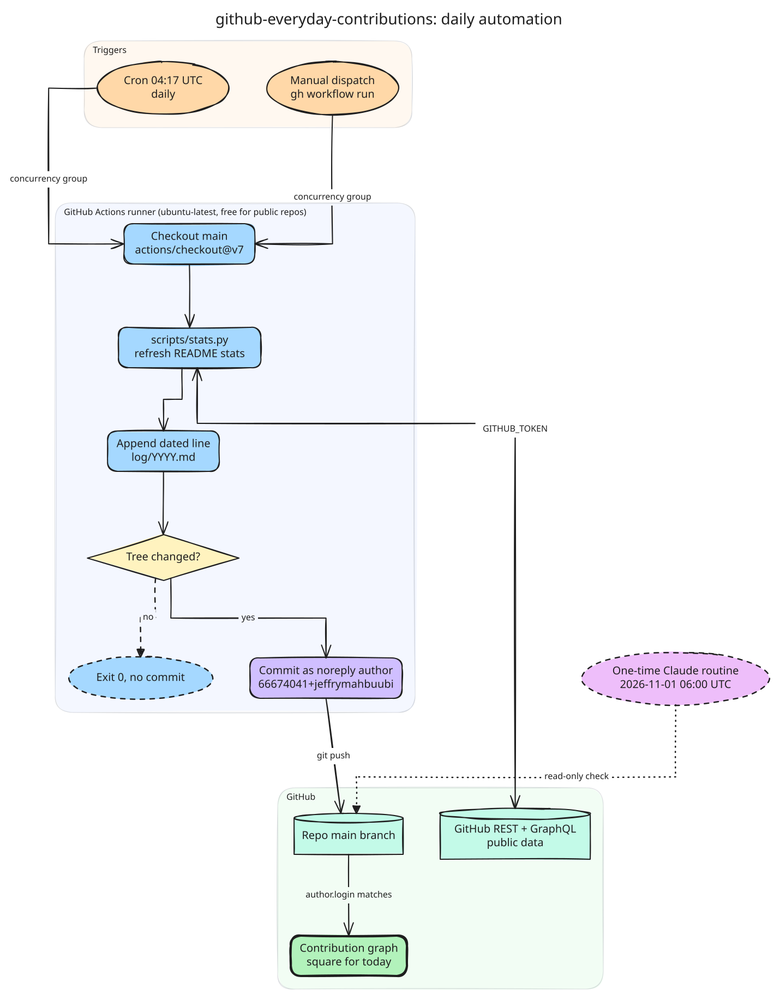

# github-everyday-contributions

An automated daily log. A scheduled GitHub Actions job refreshes the public GitHub stats below, adds one dated line to `log/<year>.md`, and commits both. The commit history is a record of the job running each day. Nothing in this repo is hand-written project work.

## Stats

<!-- stats:start -->
_Updated 2026-10-31 (UTC)._

| Metric | Value |
|---|---|
| Contributions, last 12 months | 336 |
| Current streak (days) | 9 |
| Public repos (not forks) | 26 |
| Stars on public repos | 21 |
| Top languages (by repo count) | Python (10), Jupyter Notebook (5), TypeScript (4), MATLAB (2), Shell (2) |
<!-- stats:end -->

## How it works



Diagram source: [`docs/diagrams/daily-automation.exd`](docs/diagrams/daily-automation.exd) (editable copy: `daily-automation.excalidraw`), drawn with diagram-axi.

- The workflow in `.github/workflows/daily.yml` runs every day at 04:17 UTC.
- `scripts/stats.py` rewrites the Stats section from public GitHub data. If the API fails, a value shows as `n/a` and the run still succeeds.
- It appends `- <UTC date>: daily check-in` to `log/<UTC year>.md` and pushes the commit to `main`.
- Commits are authored with the account's GitHub noreply address so they appear on the profile's contribution graph.
- If a run finds nothing to commit, it ends successfully without a commit.

## Run it by hand

From the Actions tab, pick **Daily check-in** and choose **Run workflow**, or:

```sh
gh workflow run daily.yml
```
