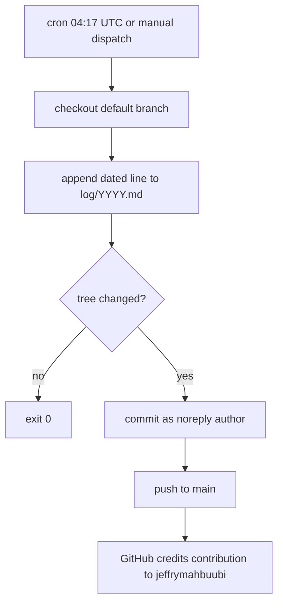

# Daily Contribution Workflow - Plan

## Goal Capsule

- **Objective:** The GitHub profile `jeffrymahbuubi` shows a contribution square every day, including days with no hands-on work. This happens with no daily action from the owner and at no cost.
- **Means:** A public repo whose scheduled GitHub Actions job appends a dated log line and commits it as the account owner (KTD1, KTD2).
- **Authority:** The Product Contract requirements win on behavior. KTDs win on mechanism. Units override neither.
- **Stop conditions:** Stop and ask the owner if publishing would expose a personal email (R6), if `jeffrymahbuubi/github-everyday-contributions` already exists on GitHub, or if a manual run's commit is not linked to the account (its author login is missing or wrong).
- **Execution profile:** Mostly config. A real run on GitHub is the proof; there is no unit-test suite.
- **Who finishes:** `ce-work` builds and verifies everything through U3. The only check left after that is confirming the first scheduled run, the next day.

---

## Product Contract

### Summary

Turn this folder into the public repo `jeffrymahbuubi/github-everyday-contributions`. Add a workflow that runs daily at about 04:00 UTC. It appends one dated line to a yearly log file and pushes a commit authored with the owner's noreply email, so GitHub credits the commit to the profile. A README says the repo is an automated log.

### Problem Frame

The owner wants an unbroken contribution graph, but stretches without active project work leave empty days. GitHub only credits commits whose author email belongs to the account and that land on the default branch of a non-fork repo. Commits made under the default Actions bot identity earn nothing. A job on the owner's Mac would miss every day the laptop is asleep or off.

### Requirements

**Daily commit**
- R1. One scheduled run per day adds a dated entry and pushes a commit to the default branch, with no owner action.
- R2. Every automated commit is authored as `66674041+jeffrymahbuubi@users.noreply.github.com` so it counts toward the profile.
- R3. The owner can trigger the same job by hand, for first-time verification and recovery.
- R4. A run that finds nothing to commit finishes successfully instead of failing.

**Cost and reliability**
- R5. Running the job costs nothing: the repo is public and uses standard GitHub-hosted runners.

**Transparency and privacy**
- R6. No tracked file or commit metadata in the public repo exposes the owner's personal email. That covers the address in the global git config and any other non-noreply address.
- R7. The README states plainly that the repo is an automated daily log.

### Key Decisions

- **Commit every day, not only to fill empty days** (session-settled: user-approved — chosen over a gap-filler that queries today's contributions first: simpler, with no API dependency that could break). Governs R1.
- **Each entry is a plain dated line.** Generated content (stats, TIL notes) is deferred. Governs R1.
- **Public repo** (session-settled: user-directed — chosen over a private repo: Actions minutes are free and unlimited for public repos, which removes the user's concern about running out of credits). Governs R5.

### Success Criteria

- On the day of setup, a manual run produces a commit that GitHub counts in the owner's contributions for that day.
- The next scheduled run succeeds without anyone touching it.

### Scope Boundaries

- Not built: gap-filler mode, generated content, a local launchd fallback, backdated history.
- Not built: protection against GitHub's 60-day scheduled-workflow suspension. The daily commits are themselves repo activity, so this should not trigger. If it ever does, the Actions tab shows it disabled and re-enabling takes one click.
- Not built: retry on push failure. Failed runs already send the owner GitHub's default failure email, and the next day's run recovers on its own.

#### Deferred to Follow-Up Work

- Layer 3 content (repo stats or a Claude `/schedule` routine) replacing the plain line.

---

## Planning Contract

### Key Technical Decisions

- KTD1. **GitHub Actions cron `17 4 * * *` plus `workflow_dispatch`** (session-settled: user-directed — chosen over a local `launchd` job: it runs while the Mac is off). 04:17 UTC is about noon at UTC+7/+8, well away from the owner's date boundary. The off-minute avoids the top-of-hour load spike, when GitHub documents that scheduled runs may be delayed or dropped. Implements R1, R3.
- KTD2. **Set the git author on the runner to the noreply address** (session-settled: user-approved — chosen over the default `github-actions[bot]` author, which GitHub does not credit). Push with the built-in `GITHUB_TOKEN` and `contents: write`; no PAT is needed. Implements R2.
- KTD3. **One log file per UTC year, `log/<YYYY>.md`, append-only.** This keeps files small and every diff a one-line addition. A second run on the same day just appends another line, which is harmless. Implements R1, R4.
- KTD4. **Commit only when the tree changed.** Otherwise exit 0. Implements R4.
- KTD5. **Run one job at a time, via a `concurrency` group.** This stops a manual run and the scheduled run from racing to push.
- KTD6. **Local commits in this repo also use the noreply email**, set as repo-local `user.email`. The global identity's personal email must never reach public commit metadata. Implements R6.
- KTD7. **Keep local agent state and session notes out of the public repo.** Gitignore `docs/handoff/` (session notes that include the personal email) and every agent-tooling store at the root: `.claude-flow/`, `.swarm/`, `agentdb.rvf`, `agentdb.rvf.lock`, `ruvector.db`, plus `*.db`, `*.db-wal`, `*.db-shm`. These are opaque binaries that a text scan cannot vet, so ignoring them is the only reliable guard. Implements R6.

### High-Level Technical Design

### Assumptions

- `gh` is logged in as `jeffrymahbuubi` with `repo` and `workflow` scopes. This was confirmed on 2026-10-31 for the login; the scopes are checked at U3.
- The default branch will be `main`.
- `actionlint` is not installed. The builder may run it with `npx`/`go run`, or skip it if neither works.

---

## Implementation Units

### U1. Repo scaffolding and privacy guard

**Goal:** A local git repo that is safe to publish.

**Requirements:** R6, R7. KTD6, KTD7.

**Dependencies:** none.

**Files:**
- `.gitignore` (create)
- `README.md` (create)
- `log/.gitkeep` (create, optional; the workflow creates `log/` itself)

**Approach:**
1. Initialize git with default branch `main`. Set repo-local `user.name` and `user.email` to the noreply identity (KTD6).
2. Gitignore the paths KTD7 lists, plus `.DS_Store`.
3. Write a short README covering what the repo is (an automated daily log for contribution continuity), when the job runs, and how to trigger it by hand.
4. Before the first commit, scan every file to be tracked with a generic email-address pattern. Every match must end in `@users.noreply.github.com`. Also search for the exact address in the global `user.email`, read at run time and never written into any file.

**Test scenarios:**
- `git config user.email` inside the repo returns the noreply address.
- Before the first commit, `git status --porcelain` lists only `.gitignore`, `README.md`, `.github/`, `docs/plans/`, and `log/` if present. No agent-tooling store or `docs/handoff/` appears.
- The email scan of tracked files finds no address outside the noreply domain, and no occurrence of the global `user.email` value.

**Verification:** First local commit exists, its author and committer emails are the noreply address, and no ignored path is tracked.

### U2. Daily workflow

**Goal:** A workflow that appends a dated line and pushes a credited commit.

**Requirements:** R1, R2, R3, R4, R5. KTD1–KTD5.

**Dependencies:** U1.

**Files:**
- `.github/workflows/daily.yml` (create)

**Approach:**
1. Triggers: `schedule` with `17 4 * * *` and `workflow_dispatch` (KTD1).
2. Permissions: `contents: write` only. Concurrency group with no cancel-in-progress (KTD5).
3. A single job on `ubuntu-latest`: check out, append `- <UTC date>: daily check-in` to `log/<UTC year>.md`, set the author identity (KTD2), commit only if the tree changed (KTD4), push.
4. Use the current major version of `actions/checkout` as of implementation time. Check its releases; don't copy a stale version.

**Execution note:** This is config. Prove it with a real run (U3), not with mocks.

**Test scenarios:**
- Manual dispatch on a fresh repo creates `log/2026.md` with one line and a commit authored by the noreply address.
- A second manual dispatch the same day appends a second line and succeeds.
- If the append step ever produces no change, the job ends green without a commit.
- Static check (`actionlint`, when it can be run) reports no errors.

**Verification:** The workflow file passes the static check, or the check is noted as skipped. U3's real runs then pass.

### U3. Publish and prove the contribution counts

**Goal:** The repo is public on GitHub and today's square is credited.

**Requirements:** R1, R2, R3, R5 and the first success criterion. The second criterion is a post-publish check (Verification Contract).

**Dependencies:** U1, U2.

**Files:** none (remote operations only).

**Approach:**
1. Check that `gh auth status` shows the `repo` and `workflow` scopes. Stop if either is missing.
2. Confirm `jeffrymahbuubi/github-everyday-contributions` does not already exist. If it does, stop (Goal Capsule stop condition).
3. Create it as a public repo from this folder and push `main`.
4. Trigger the workflow by hand and wait for it to finish.
5. Check the resulting commit's author through the GitHub API. `author.login` equal to `jeffrymahbuubi` is the pass gate for credit.
6. Query GraphQL `contributionsCollection` for today as extra evidence. GitHub can take up to 24 hours to show a contribution, so a zero count is reported as pending, not as failure.

**Test scenarios:**
- The repo's visibility is `public` and its default branch is `main`.
- The manual run concludes `success`.
- The bot commit's `author.email` is the noreply address and `author.login` is `jeffrymahbuubi`.
- Today's `totalCommitContributions` covers this repo, or is reported as pending.

**Verification:** The first three scenarios hold. Report the repo URL, the Actions run URL, and the contribution count or its pending status.

---

## Verification Contract

| Check | Unit | How | Pass signal |
|---|---|---|---|
| Privacy scan | U1 | Generic email scan of tracked files, plus a runtime lookup of the global `user.email` | Only noreply addresses |
| Tracked set | U1 | `git status --porcelain` before the first commit | Only the expected paths |
| Local author | U1 | Inspect the first commit's author and committer | Noreply address |
| Workflow lint | U2 | `actionlint` via an available runner | No errors, or noted as skipped |
| Live run | U3 | Manual dispatch, then run status | `success` |
| Credit | U3 | Commit `author.login`, plus GraphQL contributions for today | `jeffrymahbuubi`; count > 0 or pending |
| First scheduled run (post-publish) | none | Actions run list after 04:17 UTC the next day | `success` |

---

## Definition of Done

- U1–U3 verification all pass, and the repo and run URLs are reported.
- No path listed in KTD7 is in the public repo.
- No experimental or abandoned files remain in the working tree.
- The owner knows the first scheduled run is still to be confirmed after 04:17 UTC the next day.
